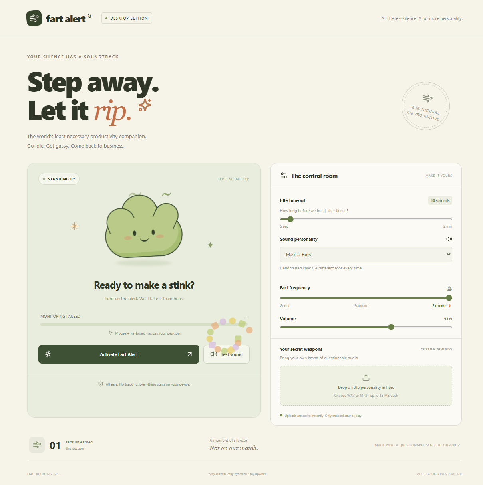

# 💨 Fart Alert

### Step away. Let it rip.

A playful desktop app that turns computer inactivity into a questionable soundtrack. Fart Alert detects system-wide mouse and keyboard inactivity, plays random fart sounds when you step away, and stops playback when you return.

Built with **Electron, React, Vite, Web Audio, and Framer Motion**. Settings and custom sounds stay on your device.



## Features

- **System-wide inactivity detection:** mouse and keyboard activity anywhere on your computer resets the idle timer, including while the app is minimized.
- **Automatic playback and stop:** repeat random sounds while idle; stop when activity resumes. Activity is checked approximately every 250 ms.
- **Configurable timeout:** 5 seconds to 2 minutes, with a 10-second default.
- **Three sound themes:** Cartoon Chaos, Heavy Duty, and Musical Farts.
- **Frequency and volume controls:** Gentle, Standard, or Extreme, plus a sound test button.
- **Custom WAV/MP3 uploads:** preview, enable, disable, and delete individual sounds.
- **Playful visuals:** animated cloud mascot, colorful particle bursts, idle progress, and a session fart counter.
- **Local persistence:** settings and uploaded sounds survive restarts. Monitoring starts paused on every launch.

## Quick start

### Requirements

- Node.js **22.12 or later** and npm; initially built and tested with Node.js 24.
- Windows for the included portable packaging script and desktop test setup.
- An audio output device with its volume turned up.
- Internet access for the initial dependency and Electron runtime downloads.

```powershell
git clone https://github.com/vams2krish/FartAlert.git
cd FartAlert
npm ci
npm run build
npm start
```

1. Click **Test sound** to check your audio.
2. Choose your timeout, sound personality, frequency, and volume.
3. Click **Activate Fart Alert**.
4. Stop using the mouse and keyboard and wait for the timeout.
5. Move the mouse or press a key to stop the idle playback.

Click **Pause Fart Alert** to disable monitoring. Minimizing the window keeps monitoring active; closing it quits the app. The app does not prevent sleep, so sleeping the computer suspends it.

## Custom sounds: upload → active → idle playback

**Uploading a valid sound automatically enables it.** No second selection is needed.

Choose one or more `.wav` or `.mp3` files in **Your secret weapons**. Each file must be **15 MB or less** and successfully decode as audio. Accepted files appear with their enabled toggle checked.

| Control or state | Behavior |
| --- | --- |
| Play icon beside a file | Preview that specific sound |
| Checked toggle | Include the file in random idle playback |
| Disabled toggle | Keep the file saved but exclude it from idle playback |
| Trash icon | Remove the saved sound |
| One or more custom sounds enabled | Randomly choose from those files instead of the built-in theme |
| All custom sounds disabled | Use the selected built-in theme again |

Random selection can repeat the same file. Previewing a file does not change its enabled state. Uploading a sound does not activate monitoring if monitoring is paused.

Files are stored locally in IndexedDB. There is no server upload, account requirement, or cloud synchronization. Clearing the app's local data removes saved files and settings.

## Sound themes and frequency

| Theme | Personality |
| --- | --- |
| Cartoon Chaos | Wobbly, bubbly synthesized toots |
| Heavy Duty | Lower-pitched, longer rumbles |
| Musical Farts | A short sequence of musical pitches |

Built-in sounds are generated locally with Web Audio. Enabled custom files override the selected theme.

| Frequency | Approximate start-to-start interval |
| --- | --- |
| Gentle | 9 seconds |
| Standard | 4 seconds |
| Extreme | 1.2 seconds |

Timing varies slightly at random. Longer sounds finish before the next idle sound starts, with a short gap. Volume changes apply to the next sound. Zero volume silences playback without pausing monitoring.

## Development commands

| Command | Purpose |
| --- | --- |
| `npm ci` | Install locked dependencies |
| `npm run dev` | Run Vite and Electron together |
| `npm run build` | Build the production renderer into `dist/` |
| `npm start` | Open the desktop app using the production build |
| `npm run preview` | Serve the built UI in a browser |
| `npm test` | Run Electron end-to-end tests |
| `npm run package` | Build a portable Windows app |

**Browser limitation:** browser preview monitors activity inside its page only. Use Electron for inactivity detection across your computer.

## Build a Windows desktop app

```powershell
npm run package
```

Open `release/Fart Alert/Fart Alert.exe`. Keep the entire generated folder together: the executable needs its accompanying runtime files. This is a portable folder build, not an installer.

Generated dependencies, runtimes, caches, and build output are excluded from Git. This repository contains source code; build the executable locally unless a separate release is published. The packaging script currently targets Windows. macOS and Linux packages have not been configured or verified.

## Architecture and privacy

1. Electron's main process reads operating-system idle duration with `powerMonitor.getSystemIdleTime()`.
2. An isolated preload bridge exposes that reading to the renderer through IPC.
3. The renderer checks the duration approximately every 250 ms against the configured timeout.
4. While idle and activated, it selects an enabled custom sound or synthesizes the chosen theme.
5. Framer Motion particles and the mascot respond to playback; further sounds follow the frequency setting.
6. Returning activity cancels pending playback and stops the current sound.

The app reads elapsed inactivity. It does not record typed keys, inspect other applications, capture screenshots, or save mouse trails. Node integration is disabled in the renderer and context isolation is enabled. There is no application backend, analytics service, or API key configuration.

```text
electron/
  main.cjs             Desktop window and system idle API
  preload.cjs          Isolated IPC bridge
src/
  main.jsx             Monitoring, settings, uploads, UI, particles
  audio.js             Web Audio synthesis and custom playback
  storage.js           IndexedDB sound persistence
  style.css            Responsive earthy visual design
scripts/package.mjs    Portable Windows packaging
tests/desktop.mjs      Electron end-to-end checks
docs/images/           Project screenshots
vite.config.js         Renderer development and build settings
```

## Verification

The production build and Electron tests passed during initial implementation, including the packaged app. Tests check the real desktop idle API, upload auto-enabling, repeated custom playback during simulated idle time, stopping on simulated return, persistence after reload, theme fallback, preview, invalid files, deletion, and renderer errors.

Tests use controlled idle readings after checking the native API. They do not physically move the mouse or verify speaker output. For a manual test, activate the app, step away until it plays, then use the mouse or keyboard in another application.

After packaging, run:

```powershell
node tests/desktop.mjs --packaged
```

## Troubleshooting

| Problem | What to check |
| --- | --- |
| No sound | Try **Test sound**, increase app and system volume, and check the audio output device. |
| No idle playback | Activate monitoring, then wait without using the computer. Use the desktop edition. |
| Theme is ignored | Disable all custom sounds; enabled uploads take priority. |
| File is rejected | Choose a decodable WAV or MP3 of 15 MB or less. |
| App will not start after cloning | Run `npm ci`, `npm run build`, then `npm start`. |
| Portable executable fails | Keep its accompanying runtime files in the generated folder. |
| Electron download runs out of space | Free disk space or put temporary files and the Electron download cache on a drive with space. |

## Contributing

Issues and pull requests are welcome. Include reproduction steps, operating system, selected theme and frequency, and whether custom sounds are enabled. Run the production build and relevant desktop tests before submitting playback changes.

## License

[ISC](LICENSE). Third-party packages retain their respective licenses.

---

*Stay curious. Stay hydrated. Stay upwind.*
